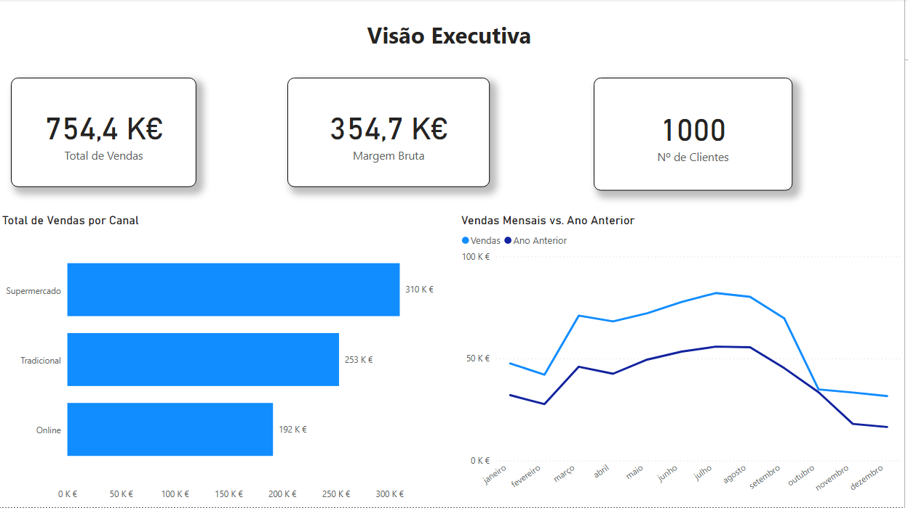
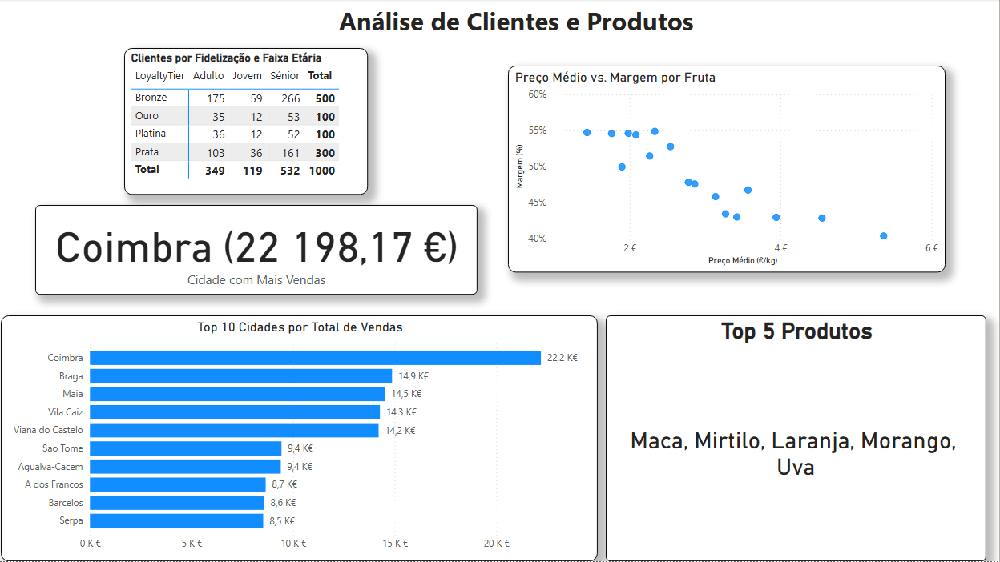

# Fruit Analytics — análise comercial de fruta

**Um dashboard para acompanhar vendas, margens, clientes, produtos e canais.**

Atividade individual de Power BI realizada no curso **Técnico/a Especialista em Gestão de Informação e Ciência dos Dados**, no IEFP Aveiro. O cenário FruitAnalytics e os dados são fictícios e educativos.

O relatório transforma um modelo dimensional de vendas numa visão executiva e em análises de clientes, produtos e evolução temporal.

## Objetivo

Responder a perguntas comerciais como:

- Que canais e categorias geram mais vendas?
- Qual é a margem bruta e como varia por produto?
- Que clientes, cidades e produtos se destacam?
- Como evoluem as vendas ao longo do tempo e qual o peso das vendas com desconto?

## O relatório

O ficheiro [`vendas.pbix`](vendas.pbix) contém o relatório Power BI com três páginas:

1. **Visão Executiva** — indicadores de vendas, margem e clientes, comparação mensal com o ano anterior e vendas por canal.
2. **Análise de Clientes e Produtos** — clientes por fidelização e faixa etária, cidades com mais vendas, relação entre preço médio por kg e margem, cidade líder e cinco produtos em destaque.
3. **Inteligência Temporal e Insights** — evolução temporal, indicadores YoY e vendas com desconto por canal.

As duas capturas abaixo documentam as páginas executiva e de clientes e produtos. A captura da terceira página não foi incluída porque o gráfico de vendas com desconto por canal ficou visualmente pouco informativo.

### Visão Executiva



### Análise de Clientes e Produtos



## Resultados apresentados

Na visão executiva, o total de vendas é **754 414,51 €**, a margem bruta é **354 686,60 €** e o relatório mostra **1 000 clientes**. O canal Supermercado lidera com **309 663,19 €**, seguido de Tradicional (**253 121,38 €**) e Online (**191 629,94 €**).

Na análise por cidade, Coimbra aparece em primeiro lugar com **22 198,17 €**. Os cinco produtos destacados são maçã, mirtilo, laranja, morango e uva. Os valores correspondem ao contexto visível nas capturas e podem mudar com filtros no relatório.

## Ferramentas e competências

- **Power BI Desktop** — construção do relatório e exploração interativa.
- **Modelação dimensional** — modelo em estrela com tabelas de vendas, produtos, lojas e clientes.
- **DAX** — colunas calculadas, medidas, filtros, inteligência temporal, rankings e percentagens.
- **Storytelling com dados** — indicadores executivos e páginas analíticas organizadas por pergunta de negócio.

## Como abrir

1. Instale o [Power BI Desktop](https://powerbi.microsoft.com/desktop/) (gratuito, Windows).
2. Transfira `vendas.pbix` deste repositório.
3. Abra o ficheiro no Power BI Desktop para explorar o relatório.

## Estrutura

```text
powerbi-fruit-analytics/
├── README.md
├── vendas.pbix
└── docs/
    ├── clientes-produtos.png
    └── visao-executiva.png
```

## Autor

**Phelipi Pinheiro** · [@Pheph](https://github.com/Pheph)
